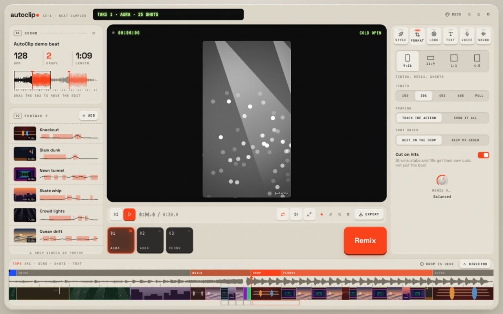
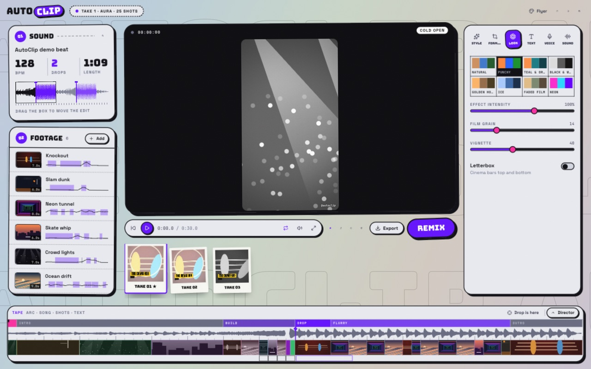
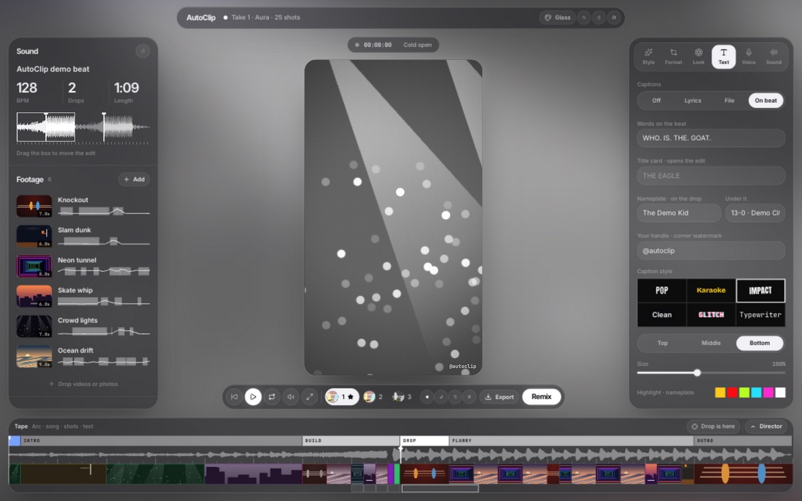
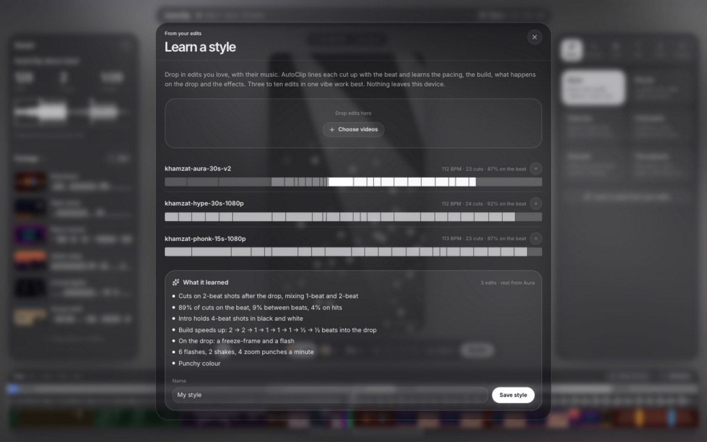
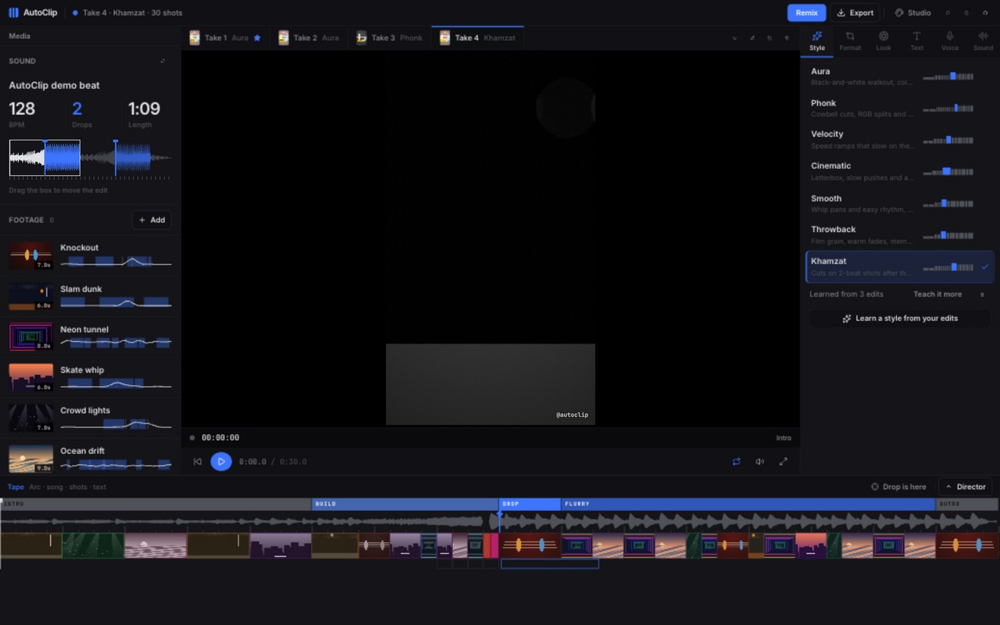
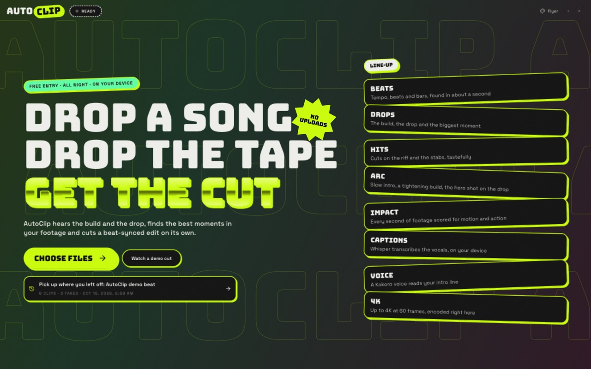
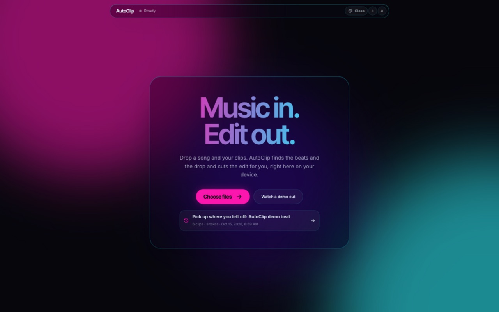

<div align="center">


# AutoClip

**Drop a song. Drop the tape. Get the cut.**

[](https://github.com/shariqsk/autoclip/actions/workflows/ci.yml)
[](https://github.com/shariqsk/autoclip/releases/latest)
[](LICENSE)

[**Download**](#download) · [**Open it in your browser**](https://shariqsk.github.io/autoclip/) · [How it cuts](#how-it-cuts) · [Features](#features) · [Run from source](#run-from-source)

</div>

AutoClip is an auto editor for beat-synced edits. Give it a song and a pile of clips (fight footage, game highlights, a trip, anything) and it hears the tempo, the build and the drop, watches every second of your footage for the moments that hit, and cuts an edit on its own: a slowed black-and-white intro, a build that tightens into the drop, the knockout landing exactly on it, and the action cut on the strongest beats after. Everything runs on your device, including the AI. Nothing is uploaded.



<p align="center"> </p>

## Download

| Platform                  | Download                                                                                                                                                                                                          | Notes                                           |
| ------------------------- | ----------------------------------------------------------------------------------------------------------------------------------------------------------------------------------------------------------------- | ----------------------------------------------- |
| **Windows** 10/11         | [**AutoClip-Setup.exe**](https://github.com/shariqsk/autoclip/releases/latest/download/AutoClip-Setup.exe)                                                                                                        | 64-bit installer                                |
| **macOS** (Apple silicon) | [**AutoClip-mac-arm64.dmg**](https://github.com/shariqsk/autoclip/releases/latest/download/AutoClip-mac-arm64.dmg)                                                                                                | M1 and newer                                    |
| **macOS** (Intel)         | [**AutoClip-mac-x64.dmg**](https://github.com/shariqsk/autoclip/releases/latest/download/AutoClip-mac-x64.dmg)                                                                                                    |                                                 |
| **Linux**                 | [**AppImage**](https://github.com/shariqsk/autoclip/releases/latest/download/AutoClip-linux-x86_64.AppImage) · [**.deb**](https://github.com/shariqsk/autoclip/releases/latest/download/AutoClip-linux-amd64.deb) | x64                                             |
| **Web**                   | [**shariqsk.github.io/autoclip**](https://shariqsk.github.io/autoclip/)                                                                                                                                           | Nothing to install. Chrome or Edge recommended. |

<details>
<summary><b>First launch: "unidentified developer" / SmartScreen warnings</b></summary>

The apps aren't code-signed yet, so your OS will ask before opening them the first time:

- **Windows:** on the blue SmartScreen screen, click **More info → Run anyway**.
- **macOS:** right-click the app in Applications and choose **Open**, then **Open** again. If macOS says the app is damaged, run `xattr -cr /Applications/AutoClip.app` in Terminal.
- **Linux (AppImage):** `chmod +x AutoClip-linux-x86_64.AppImage`, then run it.

</details>

---

## How it cuts

Most auto-editors drop a cut on every beat and call it synced. That reads as random. AutoClip plans the edit the way people cut fight and sports edits by hand, as an arc:

|     | Part          | What happens                                                                                                                                 |
| --- | ------------- | -------------------------------------------------------------------------------------------------------------------------------------------- |
| 01  | **Cold open** | A split second of the action, so nobody scrolls past.                                                                                        |
| 02  | **Intro**     | Long holds on bar lines, slowed and (in Aura) in black and white. Steady, crisp shots: the walkout, the stare, the crowd.                    |
| 03  | **Build**     | The bars before the drop cut faster and faster, down to half-beats, with the picture flickering in time with the track.                      |
| 04  | **Drop**      | The single best moment in all your footage lands exactly on it: colour slams back in, the frame freezes on the impact, a nameplate wipes in. |
| 05  | **Flurry**    | The action after the drop, cut on the strongest beats rather than a fixed count, each shot lined up so its action lands on its accent.       |
| 06  | **Outro**     | One last held shot, slowed, fading to black.                                                                                                 |

The tape along the bottom of the app draws this arc over the song's waveform and the shots, so you can see exactly why each cut is where it is.

## Features

**Hearing the song**

- **Tempo and beats:** autocorrelation with harmonic summing, a constant-tempo grid fit for music played to a click (most edit music), dynamic-programming beat tracking for music that isn't, an off-beat correction and downbeat detection.
- **Sections and drops:** bar-level timbre and harmony features feed a novelty curve; sections are rated by loudness and bass weight, and each drop is landed on the downbeat with the biggest jump. Songs with no clear drop use their biggest lift.
- **The right 15, 30, 45 or 60 seconds:** short edits open a few bars before the biggest drop and end on a bar line. Drag the box on the waveform to cut a different part, or mark the drop yourself (**Drop is here** on the tape) when the detection's wrong.

**Watching the footage**

- Every clip is decoded a few frames a second with WebCodecs and scored for motion, sudden impact, sharpness, brightness and the loudness of its own soundtrack (crowd roars and commentators count).
- Clips that are already edits are split into scenes; flashes on a punch aren't mistaken for cuts.
- The point of action is tracked through each clip, so vertical edits reframe to follow it.
- Mark a clip as **Hero** to save it for the drop, or **Bench** it.

**Six styles**

| Style         | For                           | Feel                                                                    |
| ------------- | ----------------------------- | ----------------------------------------------------------------------- |
| **Aura**      | UFC, boxing, tributes         | Black-and-white walkout, colour slamming in on a freeze-framed knockout |
| **Phonk**     | Aggressive sports, cars, gym  | Cowbell cuts, RGB splits, hard shakes, all in black and white           |
| **Velocity**  | Skate, dance, cars            | Speed ramps that slow on the hit and rip back up                        |
| **Cinematic** | Trailers, retirements, travel | Letterbox, slow pushes, a hero shot that breathes                       |
| **Smooth**    | Vlogs, travel, products       | Whip pans and an easy rhythm                                            |
| **Throwback** | Recaps, friends, old footage  | Film grain and warm fades                                               |

**Cut on hits.** Strums, stabs and fills between the beats get their own cuts (on by default), a run at most every few bars, so a three-strum riff lands three cuts without every beat becoming one.

**Learn a style from your edits.** Drop in edits you love (or paste TikTok, YouTube or Instagram links in the desktop app). AutoClip watches each one frame by frame and listens to its music, lines every cut up with the beat, and learns the pacing, how the build tightens, what happens on the drop (a hero shot, a freeze-frame, a flash), how it cuts after, the effects and the look. It shows what it learned in plain words and saves it as a style of your own, next to the built-in six. Teach it more edits any time. Three to ten edits in one vibe work best.

<p align="center"></p>

**Moments.** Long clips (a full round, a whole game) get a **Moments** button: AutoClip suggests their best few seconds, previews each on a loop, lets you trim them or drag out your own on the clip's action line, and adds the ones you pick as clips of their own. Nothing is re-encoded.

**Takes, not drafts.** Every cut is kept as a numbered take. **Remix** shoots a new one (shots you've locked stay put), **C** flips back to the last take to compare, and you can star, rename and duplicate. Changing the style or length re-cuts the current take unless you've starred or edited it.

**Director mode** (one button, hidden until you want it) opens the tape up: zoom, drag any cut (it snaps to the beat; hold Alt to move freely), and an inspector for every shot: swap the clip, slide the in-point along the clip's action line, re-pick the next-best moment, speed (1×, slow, ramp, freeze), the transition in, and every effect. Split, lock, remove, undo and redo.

**Text**

- **Lyrics, heard:** Whisper transcribes the song's vocals on your device for word-timed captions.
- **Subtitle files:** `.srt` and `.lrc` (including word-timed LRC).
- **Words on the beat:** "WHO. IS. THE. GOAT." one word per beat, landing right before the drop.
- **Title card**, a **fighter nameplate** that wipes in on the drop (name and record), and an **@handle** watermark.
- Six caption styles: pop, karaoke, impact, clean, glitch, typewriter.

**Sound**

- **The announcer:** type a line and a Kokoro voice reads it on your device, as an opener or timed to finish right as the drop hits, with the music ducked under it.
- Synthesized whooshes on whip and zoom transitions and a sub hit with a reverse swell on every drop.
- Optionally the clips' own sound under the drop, following the speed ramps.

**Look:** eight grades (natural, punchy, teal and orange, black and white, golden hour, ice, faded film, neon), effect intensity, grain, vignette and letterbox. Every effect is rendered on the GPU by one WebGL shader shared by the preview and the export, so what you see is what you get.

**Export:** one-click presets for TikTok/Reels/Shorts, YouTube, Instagram feed and a 4K60 master, or set resolution (up to 4K), frame rate (24/30/60) and quality by hand. H.264 + AAC MP4, encoded in a few seconds on your hardware. Captions as `.srt` and the soundtrack as `.wav` too.

**Songs and footage from links** (desktop app): paste a Spotify, YouTube, TikTok, Instagram, X or SoundCloud link, or just paste anywhere in the window. Spotify tracks are matched to the best upload of the song. Downloads run in parallel and retry on their own when a site refuses a stream.

**And:** autosave (your song, clips and takes are kept on your device, so closing the app loses nothing), a one-click demo that shoots its own footage and synthesizes its own track, drag-and-drop anywhere, four layouts, and a keyboard for everything.

| Key                                        | Action                           |
| ------------------------------------------ | -------------------------------- |
| <kbd>Space</kbd>                           | Play / pause                     |
| <kbd>R</kbd>                               | Remix                            |
| <kbd>C</kbd>                               | Compare with the previous take   |
| <kbd>E</kbd>                               | Export                           |
| <kbd>D</kbd>                               | Director mode                    |
| <kbd>[</kbd> <kbd>]</kbd>                  | Previous / next take             |
| <kbd>←</kbd> <kbd>→</kbd>                  | Previous / next shot             |
| <kbd>S</kbd> / <kbd>L</kbd> / <kbd>⌫</kbd> | Split / lock / remove the shot   |
| <kbd>⌘</kbd><kbd>Z</kbd>                   | Undo (with <kbd>⇧</kbd> to redo) |
| <kbd>⌘</kbd><kbd>.</kbd>                   | Change the look                  |

**Four layouts, three colourways each**

Not just colours: each layout is its own take on the whole app, down to how takes, styles and controls are drawn. Pick from the palette button, or press <kbd>⌘</kbd><kbd>.</kbd> to step through all twelve.

| Layout             | Feel                                                                                                         | Colourways              |
| ------------------ | ------------------------------------------------------------------------------------------------------------ | ----------------------- |
| **Deck** (default) | A hardware sampler: an LCD, a screen in a bezel, style keys with LEDs, knobs and a pad per take              | Bone · Graphite · Neon  |
| **Studio**         | A pro editor: media pool, viewer with take tabs, an inspector and the timeline always docked                 | Graphite · Ivory · Neon |
| **Flyer**          | A Y2K club flyer: chrome type, sticker panels, round style stickers and polaroid takes that bump on the beat | Chrome · Acid · Neon    |
| **Glass**          | Your edit blurred huge behind floating frosted glass                                                         | Night · Day · Neon      |

<p align="center"> </p>
<p align="center"></p>

## Run from source

```bash
pnpm install
pnpm dev        # http://localhost:5173
```

Click **Watch a demo cut** to see it work without any files of your own.

### Desktop app

```bash
pnpm desktop           # build and open the Electron app
pnpm dist:desktop      # package an installer for your OS into release/
```

Releases are automated: push a tag like `v1.0.0` and GitHub Actions builds the Windows, macOS and Linux apps and publishes them to the releases page. Every push to `main` deploys the web app to GitHub Pages.

## Scripts

| Command                                        | What it does                                                                                           |
| ---------------------------------------------- | ------------------------------------------------------------------------------------------------------ |
| `pnpm dev`                                     | Dev server                                                                                             |
| `pnpm build`                                   | Type-check and build the static site into `dist/`                                                      |
| `pnpm desktop` / `pnpm dist:desktop`           | Run the Electron app / package installers into `release/`                                              |
| `pnpm test`                                    | Unit tests (Vitest): beat tracking, drop detection, the arc planner, footage matching, edits, captions |
| `pnpm typecheck` / `pnpm lint` / `pnpm format` | TypeScript, oxlint, Prettier                                                                           |

## How it works

```
 song ─► decode ─► 22 kHz mono ─► worker: STFT → onset / kick / snare flux → tempo → beat grid
                                          → downbeats → bar features → novelty → sections → drops
 clips ─► 2 workers: WebCodecs frames (96 px, ~5/s) → motion · impact · sharpness · brightness
                     + clip audio loudness → interest curve, scenes (cuts), action focus, posters
                                │
                    window: the best 15–60 s around the biggest drop
                                │
             arc: tease · intro · build · hero · flurry · ride · outro   (every cut on a beat)
                                │
        matching: hero first (biggest impact), then cold open, flurry, build, intro, outro;
                  action lined up to each shot's strongest beat; no repeats, no same scene twice
                                │
                     EditPlan { shots, speed ramps, transitions, fx, hits, captions }
                ┌───────────────┴────────────────┐
     preview: <video> per clip,          export: frame-accurate WebCodecs decode per shot
     audio clock, WebGL shader           → same WebGL shader → H.264 + AAC MP4 (Mediabunny)
                └────── soundtrack: song + SFX + clip sound + voiceover, rendered offline ──────┘
```

```
electron/main.mjs           desktop shell (serves the app from app://)
src/
├── App.tsx                 picks the layout's shell, mounts the dialogs
├── components/             sound, footage, stage, takes, rail (style, format, look, text, voice, sound), tape, dialogs
│   └── shell/              the four layouts (Deck, Studio, Flyer, Glass), start screens, look picker, beat pulse
├── state/                  store, actions, derived render state, settings, autosave, playhead
├── styles/                 colourways, the shared control kit, one stylesheet per layout
├── workers/                song analysis, clip analysis, reference edits, Whisper, Kokoro
└── lib/
    ├── audio/              FFT, features, tempo and beats, structure and drops, mix, WAV
    ├── video/              frame metrics, cut detection, clip analysis, moments
    ├── learn/              reading reference edits and learning a style from them
    ├── edit/               styles, window, arc planner (slots), footage matching, plan, speed ramps, timeline, hand edits
    ├── render/             WebGL shader and compositor, live preview, MP4 export
    ├── captions/           parsing (SRT/LRC/words), six animated styles, nameplate
    ├── ml/                 model list and worker clients
    └── demo/               a synthesized club track and procedurally shot demo footage
```

### Engineering notes

- **Beat grids beat beat trackers for this music.** Dynamic-programming trackers flip between the beat and the off-beat when bass and open hi-hats sit between beats. A constant-tempo grid fit to kick-and-snare evidence nails it for anything made to a click, and DP stays as the fallback.
- **Onset latency is compensated.** Spectral flux peaks a little after an attack enters the analysis window; beat times are shifted back by the measured amount.
- **Impact over motion.** The drop's shot is scored on how much the action jumps at the hit compared with the second before it, so a landed punch beats a clip that's busy all the way through.
- **Flashes aren't cuts.** A cut has to stay changed; a frame that jumps away and comes straight back is a flash.
- **One shader, two pipelines.** The live preview feeds `<video>` frames and the exporter feeds WebCodecs frames into the same WebGL2 compositor, so effects match exactly. Decoders open on a shot's first frame and close after its last, so memory stays flat.
- **Lazy everything.** The encoder, Whisper and Kokoro load only when used; the main bundle is about 400 kB.

## Browser support

Chrome and Edge do everything (WebCodecs encode and decode, WebGPU for Whisper). Safari works with WASM for the models. The desktop app bundles Chromium, so it behaves the same everywhere.

## Credits

AutoClip stands on open models and open-source software.

**Models** (downloaded on first use, then cached; they run on your device)

| Model                                                                                  | By                          | Used for                            | License            |
| -------------------------------------------------------------------------------------- | --------------------------- | ----------------------------------- | ------------------ |
| [Whisper](https://github.com/openai/whisper) (Tiny, Base, Small, with word timestamps) | OpenAI                      | Lyric captions                      | MIT                |
| [Kokoro 82M](https://huggingface.co/hexgrad/Kokoro-82M)                                | hexgrad                     | The announcer voice                 | Apache 2.0         |
| [ONNX conversions](https://huggingface.co/onnx-community)                              | Hugging Face onnx-community | Browser-ready versions of the above | Same as each model |

**Software:** [Mediabunny](https://mediabunny.dev) (MPL 2.0) for WebCodecs decoding and MP4 muxing, [Transformers.js](https://github.com/huggingface/transformers.js) (Apache 2.0), [kokoro-js](https://github.com/hexgrad/kokoro) (Apache 2.0), [ONNX Runtime Web](https://onnxruntime.ai) (MIT), React, Vite, Tailwind CSS, [Lucide](https://lucide.dev) (ISC) and [Electron](https://www.electronjs.org) (MIT).

**Type:** Anton, Inter Tight, JetBrains Mono, Bricolage Grotesque and Bebas Neue, all under the SIL Open Font License, via [Fontsource](https://fontsource.org).

Use music and footage you have the rights to.

## License

MIT
